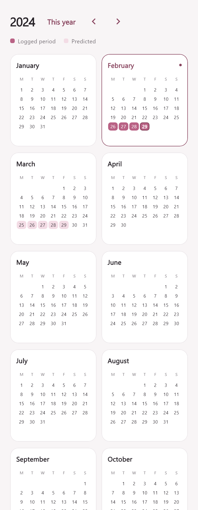

<p align="center">
  
</p>

# Mahila Mitr

Cycle tracking, shared notes, and a private space for you and your partner. Built with Flutter and Supabase, with a floral interface, illustrated stationery, and daily, monthly, and yearly calendars.

**[Download Android APK](https://github.com/veha2309/mahila-mitr-mobile/releases/download/v1.0.0/mahila-mitr.apk)** · **[Release notes](https://github.com/veha2309/mahila-mitr-mobile/releases/tag/v1.0.0)** · [Changelog](CHANGELOG.md)

**Current release: 1.0.0 · Build 1.** The Android APK is signed with a dedicated release key. Version details are also available in Settings.

## Inside the app

- **Cycle tracking:** log period dates, flow, symptoms, and notes; review your calendar history and cycle estimates.
- **Partner pairing:** connect through a short-lived, single-use invite code, or nearby Bluetooth pairing on Android. The account owner controls cycle entries.
- **Moments:** send illustrated flower, letter, and star notes, preview stationery before sending, and revisit received notes.
- **Private chat:** conversations, replies, statuses, and message timers that begin after the recipient reads the message.
- **Shared reflections:** record date ratings and reflections together.
- **Display settings:** choose Automatic, Full, Reduced, or Off effects. Drafts and scroll positions survive navigation, and layouts support larger text.

## Preview

<p align="center">
  
</p>

This rendered calendar preview uses sample data. Screenshots containing user names are excluded from the public documentation.

## Run locally

### Requirements

- Flutter **3.44 or newer**, with Dart **3.12.2 or newer**, for the bundled navigation package.
- Android SDK and a supported Java installation for Android builds; Xcode on macOS for iOS.
- A Supabase project with email OTP authentication and the database migrations below.
- A Firebase Android app for push notifications, with its matching `google-services.json` in `android/app/`.

```sh
git clone https://github.com/veha2309/mahila-mitr-mobile.git
cd mahila-mitr-mobile
flutter pub get
```

Set your Supabase project URL and **publishable** key in [`lib/config.dart`](lib/config.dart). This checkout reads those constants directly; `--dart-define` does not override them. Never put a service-role key or Firebase Admin credential in client code.

### Database and sign-in

Apply [`supabase/schema.sql`](supabase/schema.sql) in the Supabase SQL editor, followed by these migrations in order:

1. `20260916_profiles_cycle_logging.sql`
2. `20260917_day_logs.sql`
3. `20260922_partner_names_and_nicknames.sql`
4. `20260922_ephemeral_chat.sql`
5. `20260923_conversation_rooms.sql`
6. `20260924_message_ttl_and_status_effects.sql`
7. `20260925_realtime_hardening.sql`
8. `20260926_push_tokens.sql`
9. `20261016_read_triggered_expiry.sql`

All migration files are in [`supabase/`](supabase/). For an existing database, apply only migrations it has not received. The read-triggered expiry migration is required for this client.

Configure SMTP for partner accounts and public users. In **Authentication → Email Templates → Magic Link**, include `{{ .Token }}` so the email contains the code accepted by the app. If a request fails or email does not arrive, check Supabase Auth logs and your SMTP settings.

```sh
flutter run
```

### Push notifications

Deploy [`push-chat-notification`](supabase/functions/push-chat-notification) and configure its `FIREBASE_SERVICE_ACCOUNT` secret on the server. Keep the service-account JSON outside Git and client assets. The app registers FCM tokens and uses generic notification text without message previews.

Realtime/local notifications work while the app process is available. Background or terminated-app delivery requires Firebase and server configuration. iOS push additionally requires Apple credentials; this release was built and verified for Android.

## Build a release

On Windows, from the repository directory:

```powershell
./tool/build_release.ps1
```

The script reads `pubspec.yaml`, synchronizes the version in Settings, and produces:

```text
build/releases/mahila-mitr/1.0.0+1/
  mahila-mitr.apk
  release-info.json
  SHA256SUMS.txt
```

Back up `android/key.properties` and `android/app/mahila-mitr-release.keystore` securely. Updates must use the same signing key; both files are ignored by Git. See [release instructions](RELEASING.md) for versioning and publishing.

## Development

```sh
flutter analyze
flutter test test packages/platform_glass_navigation/test
```

Tests cover responsive screens, enlarged text, note layouts, loading states, calendar selection, navigation, and input restoration. On Windows, pass `--dart-define=CAPTURE_UI=true` to relevant widget tests to generate previews in `build/ui-previews/`.

| Location | Purpose |
| --- | --- |
| `lib/main.dart` | Startup, account flows, and screen integration |
| `lib/app_design.dart` | Theme, surfaces, typography, and inputs |
| `lib/notes_widgets.dart`, `lib/note_stationery.dart` | Moments, composer, and illustrated stationery |
| `lib/private_room_page.dart`, `lib/chat_widgets.dart` | Private conversations and chat presentation |
| `lib/app_activity.dart`, `lib/brand_widgets.dart` | Loading states and floral branding |
| `lib/app_navigation.dart`, `lib/navigation_card_stack.dart` | Persistent tabs and transitions |
| `packages/platform_glass_navigation/` | Bundled platform navigation implementation |
| `supabase/` | Schema, migrations, and notification function |

For isolated PostgreSQL regression checks, install `@electric-sql/pglite` into a temporary directory and run `node test/read_expiry_database_test.cjs <path-to-package>`. These tests use an in-memory database and crypto stubs, never a live project.

## Privacy and current limits

Pairing shares period history with the linked partner; the pairing flow discloses that access. Chat is encrypted on the server before storage, **not end-to-end encrypted**. The authorized server function can decrypt it.

Timers begin after the linked recipient views a message bubble in the foreground for at least 750 ms. Unread messages do not expire; changing the default timer affects future messages. Older clients do not acknowledge reads, and the migration cannot restore messages already deleted.

Cycle predictions are estimates and should not be used as contraception or medical advice. Account deletion, pairing abuse prevention, a privacy policy, and a security review remain necessary before a wider public rollout. Nearby Bluetooth pairing is implemented on Android; iOS uses manual invite codes. iOS builds and low-end device performance still need device validation.
